  

<h1 align="center">Stepper-Lab</h1>

  <b>A Scilab/Xcos model of a stepper motor and its power stage, to test control code before it reaches hardware.</b> 
  Real C code in the loop · Any input signal · Readable results

  <a href="https://antonvynohradov.github.io/Stepper-Lab/">Documentation</a> ·
  <a href="https://antonvynohradov.github.io/Stepper-Lab/downloads/Stepper-Lab_User_Manual.pdf">PDF manual</a> ·
  <a href="CHANGELOG.md">Changelog</a>

---

## Overview

Stepper-Lab runs the real C code of [Stepper-C](https://antonvynohradov.github.io/Stepper-C/), or a Scilab
prototype of it, against a model of a two-phase hybrid stepper motor, its power stage and its current
measurement. One window selects the library, the ngspice stage file, MIL or SIL and a scenario, and
Xcos diagrams with four superblocks take any signal as motion command, run current or load torque.

The power stage values come from the ngspice models of
[sfs-stepper-power-spice](https://github.com/AntonVynohradov/sfs-stepper-power-spice).

## Quick start

1. Install Scilab 2027 and, on Windows, Visual Studio or the Build Tools with the workload
   *Desktop development with C++*.
2. Clone this repository and [Stepper-C](https://github.com/AntonVynohradov/Stepper-C) next to each other.
3. In Scilab, open `start_lab.sce` and press **F5**.
4. Choose a scenario and press **Run**. The first run compiles the library.
5. Press **Report** to see the results.

The [documentation](https://antonvynohradov.github.io/Stepper-Lab/) covers the window and diagrams, MIL
and SIL, configuration, the equations, measured results and the tests.

## License

Apache License 2.0, see [LICENSE](LICENSE).

SystemFromScratch® is a registered trademark. The Apache License 2.0 grants no rights to use the
SystemFromScratch® name or logo; they may not be used to endorse or promote products derived from
Stepper-Lab without prior written permission.
