# Author & Company

{ .sfs-brand__logo }

Stepper-Lab is designed and maintained by **Anton Vynohradov** and published by
**SystemFromScratch®** — secure embedded systems and compliance-ready engineering, from concept to
certification.

## Author

**Anton Vynohradov** · [ORCID 0009-0005-6965-0911](https://orcid.org/0009-0005-6965-0911)
{ .sfs-author__name }

Embedded Systems Engineer · Secure Product Architect · Founder of SystemFromScratch®
{ .sfs-author__role }

*Embedded systems built from scratch — from bare metal to Linux, from first schematic to
certification.*

Anton designs and builds reliable, secure embedded products end to end: firmware, board support
packages and drivers, RTOS and Embedded Linux platforms, hardware bring-up, and the security and
compliance work needed to ship them. Anton is based in Poland and works remotely worldwide.

| Area | Focus |
| --- | --- |
| Embedded software | Bare-metal, RTOS and Linux firmware in C/C++, built to be maintained for years |
| BSP & drivers | Bootloaders, Zephyr drivers and Linux kernel work for MCUs, SoCs and SoC FPGAs |
| Security & compliance | Secure boot, threat modelling, MISRA C/C++, EU Cyber Resilience Act (CRA) readiness |
| Industries | Industrial IoT, automotive, robotics, medical and consumer electronics |

**Technology:** C · C++ · Python · Zephyr RTOS · FreeRTOS · Embedded Linux · Yocto · Buildroot · ARM
Cortex-M · STM32 · Microchip FPGA · RISC-V · CAN / ISO-TP · ROS 2 · Docker · Git · CI/CD · MISRA C/C++
· EU CRA

## SystemFromScratch®

SystemFromScratch® was founded by Anton Vynohradov. The company combines deep embedded engineering
with cybersecurity and certification-focused product development, for teams in industrial IoT,
automotive, robotics, medical and consumer electronics that need a partner who understands the whole
stack — silicon, firmware, operating system and the regulations that govern them.

| Service | What it covers |
| --- | --- |
| Embedded software development | Bare-metal, RTOS and Linux firmware for performance, reliability and long-term maintainability |
| BSP & device drivers | Board support packages, bootloaders and low-level drivers for MCUs, SoCs, FPGAs and custom hardware |
| RTOS & Embedded Linux | Zephyr, FreeRTOS and Embedded Linux (Yocto, Buildroot): porting, configuration, integration, reproducible builds |
| Hardware bring-up & integration | Schematic review, first boot, validation and production support, including SoC FPGA and motor-control platforms |
| Cybersecurity & CRA readiness | Secure boot, firmware integrity, threat modelling and a secure development lifecycle for the EU Cyber Resilience Act |
| Compliance & consulting | MISRA C/C++, static analysis, code and architecture reviews, compliance roadmaps |

Stepper-Lab is one of the open-source projects in the SystemFromScratch® portfolio: public engineering
work that can be inspected line by line.

## Contact

| Channel | Address |
| --- | --- |
| Website | [systemfromscratch.com](https://systemfromscratch.com) |
| E-mail | [avynohradov@systemfromscratch.com](mailto:avynohradov@systemfromscratch.com) |
| GitHub | [github.com/AntonVynohradov](https://github.com/AntonVynohradov) |
| GitHub organization | [github.com/SystemFromScratch](https://github.com/SystemFromScratch) |
| LinkedIn | [linkedin.com/in/vynohradov](https://www.linkedin.com/in/vynohradov) |
| ORCID | [0009-0005-6965-0911](https://orcid.org/0009-0005-6965-0911) |
| Location | Poland — working remotely worldwide |

Building a connected product, bringing up new hardware, or preparing for the Cyber Resilience Act? Get
in touch through [systemfromscratch.com](https://systemfromscratch.com) or by e-mail.

## Support and feedback

- **Bugs and feature requests:** open an issue on
  [GitHub](https://github.com/AntonVynohradov/Stepper-Lab/issues). Please include your Scilab version,
  the Stepper-C version, the backend, the scenario or context, and the log of `tests/run_all.sce` if
  a test fails.
- **Commercial support, integration and custom development:** contact SystemFromScratch® through
  [systemfromscratch.com](https://systemfromscratch.com).

## Trademarks and acknowledgements

SystemFromScratch® is a registered trademark. The Apache License 2.0 grants no rights to use the
SystemFromScratch® name or logo; they may not be used to endorse or promote products derived from
Stepper-Lab without prior written permission.

Motor, board and tool names (17HS19-2004S1, B-G431B-ESC1, STM32, Scilab, Xcos, ngspice) appear only to
identify the hardware and tools the model describes or uses. STM32 is a registered trademark of
STMicroelectronics International N.V.; Stepper-Lab is not affiliated with or endorsed by
STMicroelectronics, any motor manufacturer or the owners of those tools.
