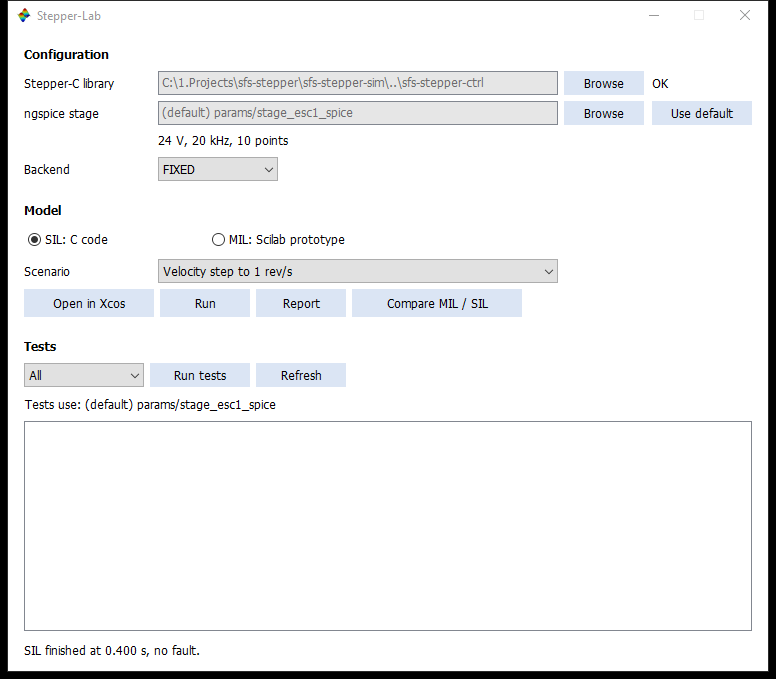
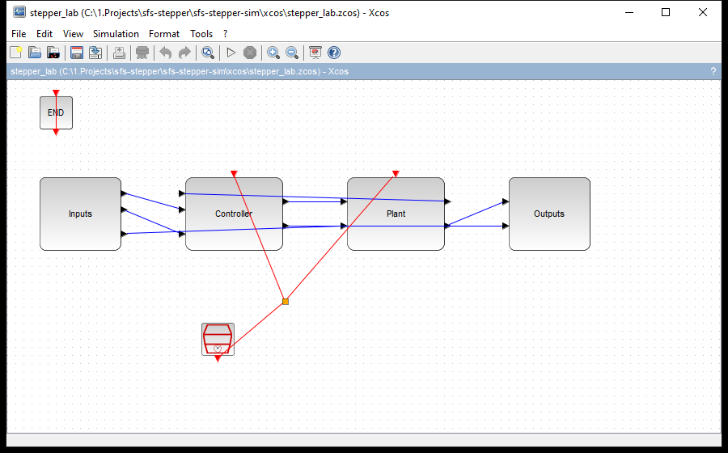
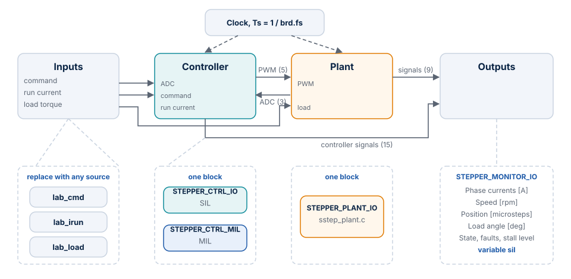
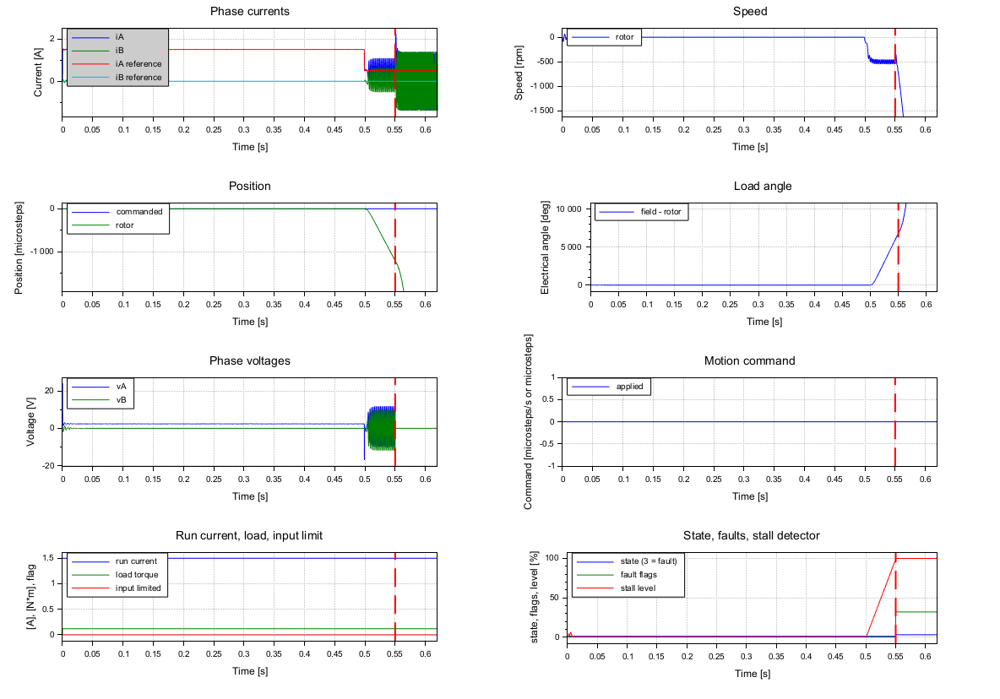

# The Lab Window and Diagrams

The Lab is the working place of this project: one window for the configuration and the runs, and
one diagram layout that takes any input signal. Open `start_lab.sce` and press F5.

## The window



| Part | Controls | What it does |
| --- | --- | --- |
| Configuration | *Stepper-C library*, **Browse** | Folder of the library, kept for the next starts. `OK` or the name of the missing file appears next to it |
| Configuration | *ngspice stage*, **Browse**, **Use default** | The [stage file](configuration.md#the-stage-file). The line below shows its bus voltage, frequency and number of table points, and warns when the board runs other values |
| Configuration | *Backend* | `FIXED` or `FLOAT`. One Scilab session links one library, so a change after linking asks for a restart |
| Model | *SIL: C code*, *MIL: Scilab prototype* | Which controller the buttons below use |
| Model | *Scenario* | One of the eight ready experiments |
| Model | **Open in Xcos** | Opens the scenario as a diagram, from a temporary file |
| Model | **Run** | Runs it without windows. The result is in the variable `sil`, and the status line names the first fault |
| Model | **Report** | Draws the last run with `sil_report()` |
| Model | **Compare MIL / SIL** | Runs both and overlays iA, speed and commanded position, with the largest difference up to the first fault |
| Tests | Group, **Run tests**, **Refresh** | Starts `tests/run_all.sce` in a second Scilab process for All, SIL, MIL or Model. **Refresh** reads the results so far, FAIL first |

The settings are saved per user; see [Settings file](configuration.md#settings-file).

## Scenarios

| No. | Name | Time | Source | Expected |
| --- | --- | --- | --- | --- |
| 1 | Current step 0.5 → 2 A, rotor locked | 0.03 s | Step on the run current at 10 ms | No fault |
| 2 | Move 2 revolutions | 0.8 s | Position command 6400 microsteps | No fault |
| 3 | Velocity step to 1 rev/s | 0.4 s | Step on the command at 50 ms | No fault |
| 4 | Velocity sine, 1 rev/s, 2 Hz | 0.6 s | Sine on the command | No fault |
| 5 | Velocity ramp to 5 rev/s | 0.5 s | Ramp from 50 ms | No fault |
| 6 | Load step 0.25 N·m, below the pull-out torque | 0.4 s | Step on the load at 0.2 s, stall detection on | No fault |
| 7 | Load step 0.5 N·m, above the pull-out torque | 0.4 s | Step on the load at 0.2 s, stall detection on | Stall fault |
| 8 | Stall at the hold current, 0.12 N·m | 0.62 s | Constant load, 1.5 A run, 0.5 A hold after 0.5 s, stall detection on | Stall fault |

Test S10 runs all eight and checks these expectations.

## The diagram

`xcos/stepper_lab.zcos` (SIL) and `xcos/stepper_lab_mil.zcos` (MIL) have the same four superblocks.
Double-click one to open it.



The figure below shows what the superblocks hold and how they connect.



| Superblock | Holds | You change |
| --- | --- | --- |
| Inputs | Three `CONST_m` sources: `lab_cmd`, `lab_irun`, `lab_load` | Replace a source with any block of the Xcos palette |
| Controller | `STEPPER_CTRL_IO` (SIL) or `STEPPER_CTRL_MIL` (MIL) | Nothing |
| Plant | `STEPPER_PLANT_IO`: power stage, motor and ADC | Nothing; its parameters come from the context |
| Outputs | `STEPPER_MONITOR_IO`, five named scopes, and the workspace block writing `sil` | Scope ranges, through `scope_i`, `scope_rpm`, `scope_pos` |

### Use your own signal

1. In the window, choose a scenario and press **Open in Xcos**. This links the library.
2. Open **Simulation → Set Context**. A scenario adds its own lines at the end of the context, such as
   `T_end`, `lab_mode` or `lab_cmd`, and these win over the lines above them. Change your values there.
3. Open the superblock **Inputs** and replace the source with, for example, `STEP_FUNCTION`,
   `GENSIN_f` or `RAMP`.
4. Press Start. The scopes show the run, and `sil` holds the results when it ends.

To open `xcos/stepper_lab.zcos` directly, first run `exec("loader.sce", -1);` and `sil_build("FIXED");` in
Scilab. Otherwise the functions of the context and the C blocks are not there, and Start fails.

### The three inputs

| Input | Unit | Read | Limits |
| --- | --- | --- | --- |
| Motion command | Microsteps/s with `lab_mode = 1`; microsteps with `lab_mode = 2`; unused with `lab_mode = 0` | Once per slow period (1 kHz) | Velocity to ±`mp.v_max`; position to the `int32_t` range |
| Run current | A | Once per slow period | 1 mA to the smaller of the rated current and the overcurrent trip. The hold current becomes the smaller of hold and run |
| Load torque | N·m | Input of the plant | None. A value that is not finite keeps the last one, without a flag in column 23 |

| `lab_mode` | Motion command | Library call in SIL |
| --- | --- | --- |
| 1 | Velocity | `sstep_run()` |
| 2 | Position | `sstep_move_to()` |
| 0 | The table `cmds`, `[t kind value]`: 1 MOVE, 2 RUN, 3 STOP | As in the table |

Behavior of the command and current inputs:

- A value is rounded and limited. A `NaN` keeps the last value. In both cases column 23 of
  `sil.values` shows the flag for that slow period.
- A new value is applied only when it differs from the last one.
- The motion generator of the library still limits acceleration and speed, so the applied command
  (column 20) is not the speed of the rotor.
- After a fault the inputs are ignored, the outputs stay off, and the simulation goes on to `T_end`.

## Results

The diagram writes `sil.time` and `sil.values`; the columns are in
[Reference](reference.md#results-silvalues).

```scilab
res = lab_run("SIL", 7);        // load step above the pull-out torque
d = sil_report_data(res);
mprintf("%s at %.1f ms\n", d.fault_names, d.t_fault * 1e3);
```

```scilab
// no-run
sil_report(res);        // opens a figure
```

`sil_report(sil, visible)` draws every group with title, unit, legend and grid, and marks the first
fault. The vertical scales come from the run up to shortly after the fault, so what follows it does not
hide the rest. `sil_report_data(sil)` gives the same content as data, without graphics.



## Common mistakes

| Symptom | Cause | What to do |
| --- | --- | --- |
| The status asks for the folder of Stepper-C | The library was not found in the search order | Press **Browse**; the folder must hold `sstep.h`, `inc/sstep_ctrl.h` and `src/sstep_ctrl.c` |
| "Restart Scilab to use FLOAT" | This session already linked the other backend | Restart Scilab |
| "Restart Scilab to link the library of the new folder" | The folder changed after linking | Restart Scilab |
| The speed does not follow a fast command | The motion generator limits it with `mp.v_max`, `mp.acc`, `mp.dec` | Raise these in the context; column 20 shows what was applied |
| Column 23 is 1 | An input is out of range or `NaN` | See the limits above |
| MIL outputs stay at zero with state 3 and flag 16 | The configuration is one the library refuses, or it asks for voltage drive | Read the printed message; `lab_run()` raises it as an error |
| A run in MIL takes long | The prototype is interpreted Scilab: 15 s per simulated second on a 0.15 s run | Use SIL for everyday runs |
| A selected stage file shows a message and is not used | The file is not valid; the message names the file and the field | Fix the export, or press **Use default** |
