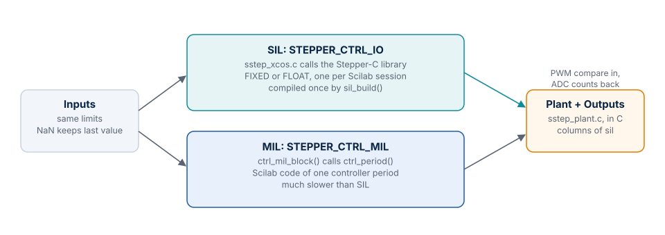

# MIL and SIL

Both modes run the same plant in the same diagram layout. They differ only in the controller block,
so a difference in the results points at the controller.



## What runs in each

| | SIL | MIL |
| --- | --- | --- |
| Block | `STEPPER_CTRL_IO` | `STEPPER_CTRL_MIL` |
| Controller | The Stepper-C library, called by `sil/c/sstep_xcos.c` | `ctrl_mil_block()`, which calls `ctrl_period()` |
| Numeric form | Q15 or float, as on the MCU | Scilab doubles, with the integer motion generator of the library |
| Plant | `sil/c/sstep_plant.c` | The same |
| Input limits | `sstep_xcos.c` | `ctrl_mil_limit()`, the same limits |
| Speed | Used for everyday runs | 15 s per simulated second on a 0.15 s run |
| Use it to | Test the code that ships | Study or change the algorithm without compiling it |

The compiled library is needed in both modes, because the plant and the monitor are C blocks in MIL too.
`lab_run()` and **Open in Xcos** link it by themselves.

## Backends

Stepper-C has two numeric backends. `sil_build(backend)` compiles the chosen one into
`sil/build/fixed` or `sil/build/float`, once, and again when a source file changes.

| Backend | Numbers | For |
| --- | --- | --- |
| `FIXED` | Q15 | MCUs without an FPU |
| `FLOAT` | Single precision | MCUs with an FPU |

A Scilab session links one backend. To change it, select the other one in the window and restart
Scilab. `tests/run_all.sce` does this by starting a second Scilab process for FLOAT.

## How close they are

Tests M01 and S01 to S06 compare the modes sample by sample. These are the limits they enforce and
the values measured on the final run:

| Comparison | Limit | Measured |
| --- | --- | --- |
| MIL against SIL, current step, phase currents | 5 mA | 1.02 mA |
| MIL against SIL, move of 640 microsteps, phase currents | 5 mA | 1.28 mA |
| MIL against SIL, commanded position | 1e-6 microsteps | 0 |
| MIL against SIL, load step above pull-out | Same fault within 1 ms | `OVERCURRENT` and `STALL` at 204.9 ms in both |

After the rotor slips, the ADC quantization is amplified and the samples diverge, so a comparison
of samples after a pull-out means little. The stall tests compare the fault and its time there.

`Compare MIL / SIL` shows this for any scenario, and reports differences only up to the first fault.
From a script:

```scilab
rs = lab_run("SIL", 1);
rm = lab_run("MIL", 1);
c = lab_compare_data(rs, rm);
mprintf("%s\n", c.panels(1).title);
```

## A configuration the library refuses

Stepper-C checks its configuration in `sstep_init()`.

- **In SIL** the simulation stops with the message of the library.
- **In MIL** the block asks the library the same question at the start. If the answer is no, or if
  the configuration asks for voltage drive (`ctl.drive = 1`), which the prototype does not have, the
  outputs stay off, the state is 3, the fault flags are 16, and the reason is printed.
  `lab_run()` raises the reason as an error, so the window shows it. In Xcos no dialog appears and
  the run reaches `T_end`, because an error raised in this kind of block at its start ends Scilab
  2027.

## The `stepper_sil` diagram

`xcos/stepper_sil.zcos`, opened by `start_sil.sce`, is the first SIL diagram of the project and is
kept as it was. It has a flat layout, and its input is the command table.

| Context variable | Meaning | Example |
| --- | --- | --- |
| `cmds` | Commands `[t kind value]`: 1 MOVE to, 2 RUN, 3 STOP | `[0 2 12800; 0.15 2 -12800]` |
| `loads` | Load torque steps `[t TL]` | `[0 0; 0.15 0.25]` |
| `brd.topology` | `"shared"` or `"full"` | `"full"` |
| `brd.stage` | `"avg"` or `"switching"` | `"switching"` |
| `mp`, `ctl` | Motion and control settings | `mp.v_max = 25600` |
| `locked` | 1: rotor locked | `1` |
| `T_end` | Simulated time, s | `1.0` |

Its results have the first 19 columns of [`sil.values`](reference.md#results-silvalues).
