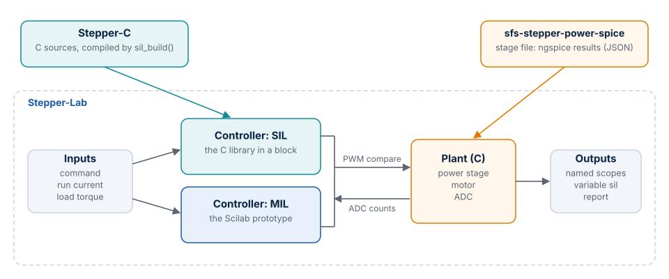

# Introduction

Stepper-Lab is a Scilab/Xcos model of a two-phase hybrid stepper motor with its power stage and
current measurement. It lets you run the control code of
[Stepper-C](https://antonvynohradov.github.io/Stepper-C/) against that model on a PC, drive it
with any signal, and read the results, before the code reaches hardware.

## What it does and does not do

| It does | Why |
| --- | --- |
| Runs the real C code of Stepper-C inside an Xcos diagram (software in the loop, SIL) | The code under test is the code that ships: ADC counts in, PWM compare values out |
| Runs a Scilab prototype of the same controller in the same layout (model in the loop, MIL) | An algorithm can be changed and studied without compiling it |
| Accepts any Xcos source as motion command, run current or load torque | Step, sine, ramp and your own signals use the same three inputs |
| Models the power stage as averaged or switching, with results from ngspice | The fast model is enough for most runs; the slow one shows ripple and dead time |
| Checks itself: tests against theory, against a Python twin, and between MIL and SIL | Each model is checked by something other than itself |

| It does not | Why |
| --- | --- |
| Replace measurements on your motor | Back-EMF constant, friction and detent torque of the example motor are derived or assumed; [Configuration](configuration.md#motor-mot) marks which |
| Control a real motor | It is a simulation; the firmware that uses Stepper-C is a separate matter |
| Include Stepper-C | The library has its own repository; you select its folder |
| Run ngspice | The window only selects a stage file that `sfs-stepper-power-spice` has exported |
| Model temperature, saturation or the motor beyond its two-phase equations | The equations are in [Motor and Control Model](model.md) |

## Who it is for

Embedded and control engineers who work with stepper motors and want to see what a controller
does before the first power-up. No Scilab knowledge is needed for the first runs: the
[Lab window](lab.md) holds the choices, and the scenarios are ready to run.

## Related projects

| Project | Role here |
| --- | --- |
| [Stepper-C](https://antonvynohradov.github.io/Stepper-C/) | The control library under test. Its sources are compiled into the SIL blocks |
| [sfs-stepper-power-spice](https://github.com/AntonVynohradov/sfs-stepper-power-spice) | ngspice models of the power stage. Its export is the stage file: leg resistance, diode voltage, effective dead time and the leg voltage error table |

**Rule of this project:** the Scilab model follows the algorithm of the library. A change in
Stepper-C is ported to the prototype and to the Python twin in the same step, and the tests show
whether they still agree.

## Key properties

| Property | Value |
| --- | --- |
| Tool | Scilab 2027 with Xcos; a C compiler for the plant and the library |
| Example motor | 17HS19-2004S1: 1.60 Ω, 3.0 mH, 2.0 A, 200 steps per revolution |
| Example board | B-G431B-ESC1: 24 V, 20 kHz PWM, three legs with a shared leg |
| Controllers | SIL (C, FIXED or FLOAT backend), MIL (Scilab) |
| Stepper-C version used for the results | `main` at commit `3ef0f7e`, which reports itself as 1.1.0 and has stall detection fixes made after the tag `v1.1.0` |
| Tests | 433 checks, 0 failures on the final full run ([Verification](verification.md)) |
| Platform of all results | Windows 10 with Scilab 2027.0.0 |
| License | Apache License 2.0 |

## Terminology

| Term | Meaning |
| --- | --- |
| SIL | Software in the loop: the compiled C library runs against the model |
| MIL | Model in the loop: the Scilab prototype of the controller runs against the same model |
| Plant | Power stage, motor and current measurement: everything the controller acts on |
| Prototype | The Scilab implementation of the controller (`model/ctrl_period.sci` and the functions it calls) |
| Python twin | Independent Python implementation of parts of the model, in `tools/`; it checks the Scilab results |
| Stage file | JSON export of `sfs-stepper-power-spice` with the measured values of a power stage |
| Scenario | A ready experiment of the window: context lines and source blocks |
| Backend | The numeric form of Stepper-C: `FIXED` (Q15) or `FLOAT` |
| Fast loop, slow loop | The two periods of Stepper-C: 20 kHz current control, 1 kHz motion |
| Load angle | Electrical angle between the commanded field and the rotor; beyond 90° the rotor is past its pull-out point |

## Conventions

- Units are SI unless stated. Positions are in microsteps, with 3200 microsteps per revolution at
  16 microsteps per full step.
- Functions are written `sil_report()`, and files by their path from the repository root.
- The current vector is `iA = I cos(phi)`, `iB = I sin(phi)`, and the rotor settles at
  `p theta = phi`. Increasing `phi` turns the rotor forward. Stepper-C uses the same convention.
