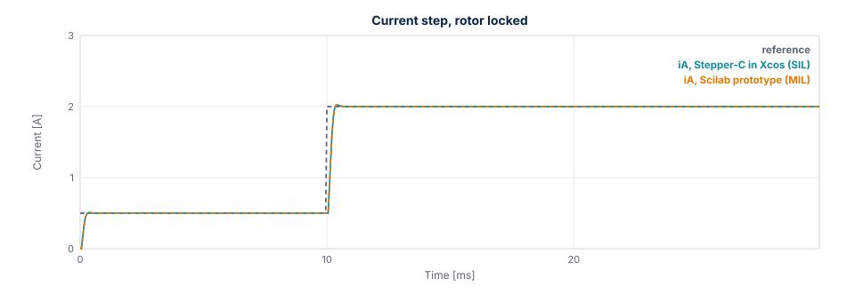
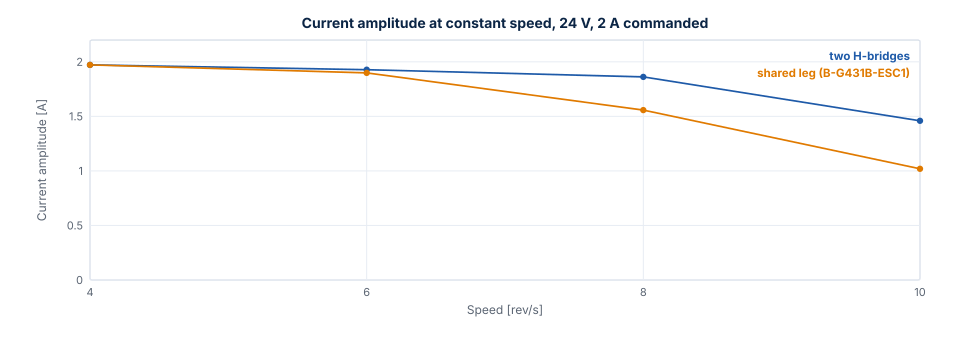
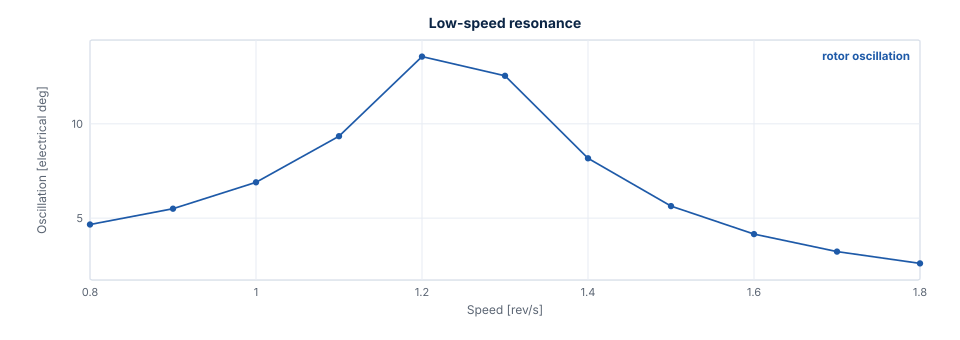
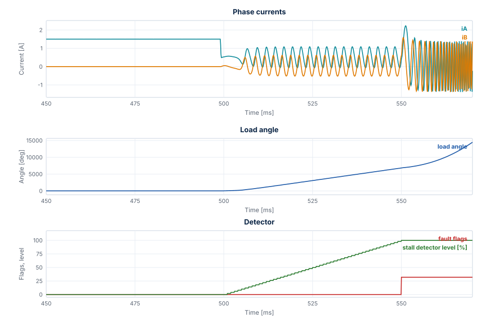

# Measured Results

This chapter shows what the model says about the example: 17HS19-2004S1, 24 V, 2 A, 20 kHz, 1 kHz current
loop bandwidth. "Measured" means measured on the model. These are simulation results, valid as far as the
[parameters](configuration.md#motor-mot) are, and they have not been compared here with a real motor.

## Current loop

A 0 → 2 A step on a locked rotor, in test T04, gives the same result on both topologies:

| Overshoot | Rise (90 %) | Settling (2 %) | Steady error |
| --- | --- | --- | --- |
| 1.12 % | 0.350 ms | 0.400 ms | 0.009 % |

The figure shows the first Lab scenario, a step from 0.5 to 2 A, with both controllers. The two curves lie
on top of each other: they differ by at most 1.2 mA in this run, and the ADC step is 1.95 mA.

## Voltage limit

The current amplitude falls with speed once the bridge reaches its voltage limit. The shared leg reaches
it first, because its largest amplitude is $V_{bus} / \sqrt{2}$.

| Speed | Two H-bridges | Shared leg (B-G431B-ESC1) |
| --- | --- | --- |
| 4 rev/s | 1.97 A | 1.97 A |
| 6 rev/s | 1.93 A | 1.90 A |
| 8 rev/s | 1.86 A | 1.56 A |
| 10 rev/s | 1.46 A | 1.02 A |

Below the limit the amplitude drops slightly with speed, because the current loop lags the rotating
reference.

Higher speeds are left out: from about 11 rev/s on the shared leg the operating point is a limit cycle (see
below), so a mean amplitude depends on the time window it is taken over.

## Resonance

**Natural frequency.** The rotor on the current vector oscillates at $\sqrt{p K_t I / J} / 2\pi$, which is
253.8 Hz at 2 A without load. The loop gives 248.1 Hz (test T11).

**Low-speed resonance.** A detent torque excites it when $4 p n$ equals the natural frequency, about
1.27 rev/s. With 0.02 N·m, which is an assumption and not a datasheet value, the rotor oscillation peaks at
1.2 rev/s, at 13.6 electrical degrees. Avoid running continuously around this speed, or add load inertia or damping.

**Mid-band instability.** Below the voltage limit the current loop damps the rotor. Once the bridge limits
the voltage the oscillation grows. A higher bus voltage moves this up.

| Speed, shared leg, 24 V | Oscillation (electrical) | Voltage scale |
| --- | --- | --- |
| 5 rev/s | 0.0° | 1.00 |
| 8 rev/s | 1.3° | 0.51 |
| 11 rev/s | 47.6°, a limit cycle | 0.30 |

## Parameter uncertainty

With the gains for the nominal motor and a different plant (test T08):

| Plant | Overshoot | Settling (2 %) | Steady error |
| --- | --- | --- | --- |
| R ×0.9, L ×0.8 | 5.16 % | 0.450 ms | 0.060 % |
| R ×0.9, L ×1.2 | 2.15 % | 1.000 ms | 0.216 % |
| R ×1.3, L ×0.8 (hot winding) | 1.99 % | 1.600 ms | 0.344 % |
| R ×1.3, L ×1.2 | −0.06 % | 0.550 ms | 0.060 % |

A ramp to 4 rev/s stays synchronous with R ×1.3, L ×0.8, J ×5 and 0.15 N·m of load: the load angle reaches 46.3°.

## Power stage

| Result | Value | Test |
| --- | --- | --- |
| Ideal switching stage against the averaged model | At most 0.0113 mA | T10 |
| Ripple at 2 A, locked phase | 23.11 mA p-p, equal to the formula | T10 |
| Dead time voltage error at 133 ns | 0.135 V per phase, 0.07 mV from the formula | T10 |
| Peak current at 4 rev/s with dead time | 2.027 A | T10 |
| Commanded voltage against the switching stage, 4 rev/s, ideal legs | 118 mV | S05 |
| The same with the ngspice leg error table | 19 mV, amplitude 1.9702 A against 1.9701 A | S05 |

## Stall detection

Configuration: `ctrl_default()` with `stall_time_ms = 50`. Pull-out means a load angle beyond 90°. Steps lost
is the difference between commanded and rotor position at the fault. The values are from the prototype and
the C library, on the averaged stage with the ngspice leg error and on the switching stage. Where they
differ, the table gives a range.

The figure shows Lab scenario 8: the hold current starts at 500 ms, the rotor slips under 0.12 N·m, the
detector level rises to 100 %, and the fault switches the outputs off at 550.0 ms.

| Must trip | Fault | Time | After the pull-out | Full steps lost |
| --- | --- | --- | --- | --- |
| 0.12 N·m, run 1.5 A, hold 0.5 A after 500 ms | Stall | 550.0 ms | 48.1 ms | 76.4 to 76.7 |
| Blocked rotor, run 1 rev/s from rest | Stall | 60.0 ms | 45.9 ms | 10.0 |
| 0.5 N·m load step at 1 rev/s | Overcurrent and stall | 154.9 ms | 3.7 ms | 13.4 |
| Overload at start: 0.5 N·m, run 1 rev/s | Overcurrent and stall | 39.5 to 40.3 ms | 38 to 39 ms | 1298 to 1354 |
| Heavy axis, J ×100, 0.5 N·m at 1 rev/s | Stall | 212.0 ms | 57.6 ms | 36.1 |
| Heavy axis, J ×20, 0.5 N·m at 3 rev/s | Stall | 316.0 ms | 61.1 ms | 162.9 |

| Must not trip | Largest detector level |
| --- | --- |
| Enable, run → hold 2 → 1 A, plant R +30 %, L −20 % | 52 to 54 % |
| Enable, run → hold 1.5 → 0.5 A with 0.07 N·m | 6 % |
| 0.30 N·m at ±1 and ±3 rev/s, plant R +30 %, L −20 % | 18 % |
| 4 rev/s, plant R +30 %, L −20 %, J ×5, 0.15 N·m | 26 % |
| Move of 6400 microsteps; reversal ±4 rev/s; 8 rev/s on both topologies | 0 % |
| Detent 0.02 N·m, 0.8 to 1.8 rev/s | 0 % |
| Mid-band 5, 8 and 11 rev/s, load angle up to 107°, no step lost | 0 % |
| 8 rev/s at 18 V, 9 rev/s at 20 V | 0 % |
| 11 rev/s at 24 V, plant L +20 %, load angle up to 149°, no step lost | 2 % |

The verdict asks for the stall flag in the **first** fault, also together with the overcurrent flag: a bare
rotor torn away by a large load reaches the overcurrent trip before `stall_time_ms`.

**Agreement.** The run in Xcos equals the prototype: the same fault within one slow period, and currents
within 5 mA while the rotor is synchronous. After a pull-out the free slip amplifies the ADC quantization,
and the 11 rev/s limit cycle grows from it, so those cases are compared by their verdict only.

**After a fault.** The outputs are off, which in the Xcos plant means 0 V on the phases, and the load torque
stays as an input. A constant load then keeps accelerating the free rotor without limit, and the simulated
currents and speed reach values that mean nothing. Read a result up to the fault.

**Limits of the detector:**

- A rotor that stops while the command is below `stall_speed` is not seen. A rotor blocked at 0.4 rev/s gives
  no fault and a detector level of 0 % in 0.5 s, while blocked at 1 rev/s it trips at 60.0 ms.
- A load angle swinging repeatedly beyond about 120° near the voltage limit is reported before a full step is
  lost. At 11 rev/s and 20 V the fault comes at 250.0 ms, with the rotor 0.83 full steps from the command.

## Where these numbers come from

Each comes from a line of the test log of the final full run, or from the data of a figure, which
`tools/docs/export_figures.sce` writes with the setups of the tests. Run the tests or the export to measure
them again; [Verification](verification.md) shows how.
